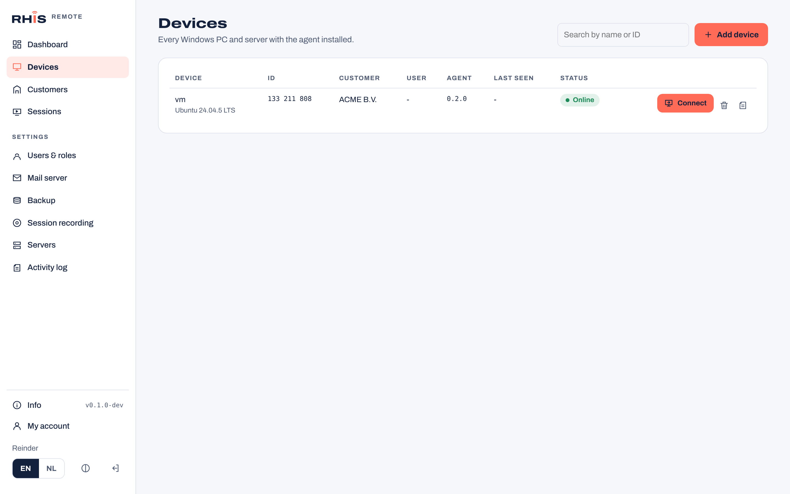
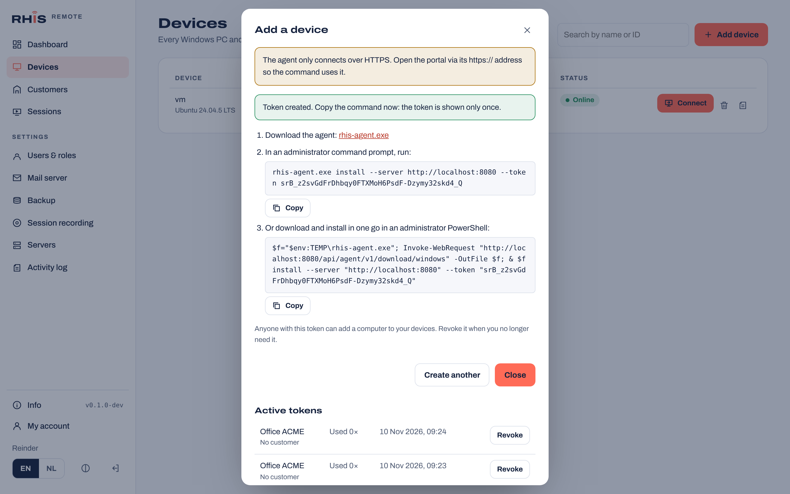
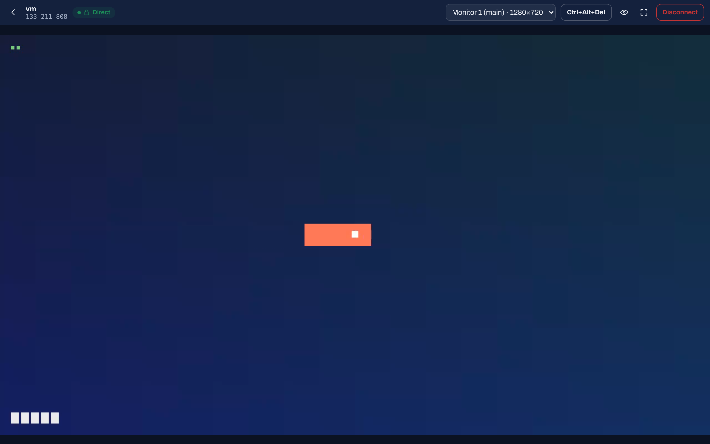
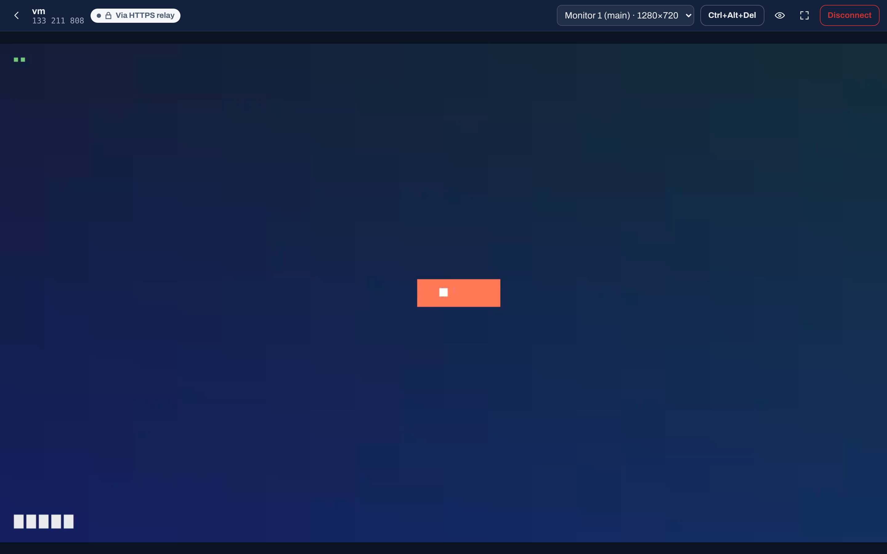
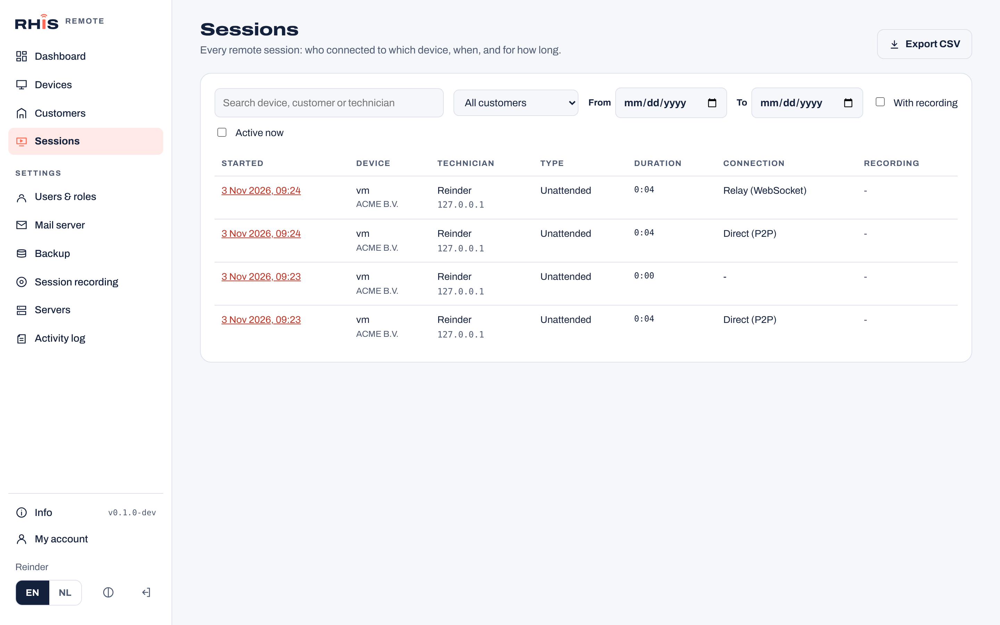

# RHIS Remote

Self-hosted remote support for Windows: remote control with unattended access, a one-off quick support client, and a modular server that runs on a single Debian 13 machine and scales out to multiple servers.

> **Status:** early development. Version 0.1 contains the server foundation and the admin portal. Version 0.2 adds the Windows agent with unattended access (in test, not yet run on real Windows hardware). The quick support client and client builder come next, see the [roadmap](ROADMAP.md).


## What is in the server today

- **Admin portal** in the RHIS house style, English by default with a full Dutch translation, light and dark theme, menu on the left.
- **Users and roles:** administrators and technicians, Argon2id password hashing, login rate limiting, activity log.
- **Mail server:** your own SMTP server with STARTTLS or implicit TLS (minimum TLS 1.2 or 1.3), authentication by SCRAM-SHA-256, PLAIN, LOGIN, CRAM-MD5 or XOAUTH2, and a test email from the portal.
- **Backup and restore:** full and incremental backups of the database and data folder to FTP, FTPS (explicit or implicit) or SCP over SSH, on a schedule or by hand, optionally encrypted with [age](https://age-encryption.org). Retention keeps the newest N full backups. Restore works from the remote location, also on a fresh server.
- **Info and updates:** the Info button shows the version and checks GitHub releases. Switch between the production and test channel and install an update from the portal.
- **Windows agent (unattended access):** a Rust agent that runs as a Windows service on Windows 11 and Windows Server. It connects out to the server over HTTPS/WSS on port 443, so it works behind any NAT router without port forwarding. The technician opens the device in the browser and gets the screen over WebRTC (H.264, encrypted with DTLS-SRTP), with TURN relays and an encrypted WebSocket relay over 443 as fallbacks. Mouse, keyboard, multiple monitors, Ctrl+Alt+Del, the sign-in and UAC screens, view-only mode and full screen are supported. The customer sees a banner while a session is active. See [Windows agent](#windows-agent) and [docs/agent-protocol.md](docs/agent-protocol.md).
- **Session audit and recording:** every remote session is logged (technician, device, customer, time, duration, connection type, IP) with a timeline of what happened, filterable and exportable as CSV. Optional video recording (off, technician chooses, or always), stored encrypted on the server, with playback, download, retention and private share links for customers. See [docs/session-recording.md](docs/session-recording.md).
- **One binary, several roles, scales out:** `roles: ["all"]` on one machine, including a TURN relay for connections behind strict NAT. Add relay servers close to your customers with a one-time token from the portal (no database needed, they update themselves), or run several control servers on a shared PostgreSQL with NATS. All traffic between servers is encrypted. See [docs/scaling.md](docs/scaling.md).

## Screenshots

All screenshots are taken from a real `v0.1.0-test.1` server. The backups shown were made to an FTPS server.

| | |
| --- | --- |
|  **Sign in** |  **Dark theme, Dutch** |
|  **Users and roles** |  **Mail server (SMTP)** |
|  **Backup history and restore** |  **Info, update channel and updates** |
|  **Activity log** |  **Session recording settings** |
|  **Session log** |  **Session details, recording and timeline** |
|  **Share a recording with a customer** |  **What the customer sees (Dutch)** |
|  **Sessions, dark theme, Dutch** |  **Servers: control server and relays** |
|  **Devices with online status** |  **Add a device: enrollment token and install command** |
|  **Remote session, direct WebRTC connection** |  **Same session over the encrypted HTTPS relay** |
|  **Agent sessions in the session log** | |
|  **Add a relay server with a one-time token** |  **Servers, dark theme, Dutch** |

The device and remote session screenshots come from a real server with the agent running in its Linux test mode, which draws a synthetic screen; the Windows build captures the real desktop. The Servers screenshots show a real control server with a relay that joined with a token, plus one demo relay; the session screenshots use demo data; the recording in them was made by a real browser with the portal's recorder and played back from the encrypted store.

## Roadmap

| Phase | Status |
| --- | --- |
| 1. Server foundation | Done (v0.1) |
| 2. Windows agent and connectivity (NAT traversal, WebRTC, relay) | In test (v0.2), Windows hardware test pending |
| 3. Quick support client (no install, session code) | Planned |
| 4. Session audit and recording | In test, including agent sessions |
| 5. Client builder and signed central updates | Planned |
| 6. Multi-server and scale-out (relays, NATS cluster) | Relays, cluster and Servers page in test |
| 7. Code signing and open-source release | Planned |

Details per phase are in [ROADMAP.md](ROADMAP.md) and in the [roadmap issues](https://github.com/rhisijmuiden/remote-support-tool/issues?q=label%3Aroadmap).

## Install on Debian 13

```bash
curl -fsSLO https://raw.githubusercontent.com/rhisijmuiden/remote-support-tool/main/deploy/debian/install.sh
sudo bash install.sh --domain remote.example.com   # HTTPS with a Let's Encrypt certificate
# or: sudo bash install.sh                         # https://<server-ip> with an internal certificate
# or: sudo bash install.sh --channel test          # newest test pre-release
# add --public-ip <address> when the server is behind NAT, for the built-in TURN relay
```

A separate relay server is installed with the command from **Settings > Servers > Add relay server** (`install.sh --role relay ...`). Forward 3478 UDP+TCP and 49160-49359 UDP straight to the server running the relay, past any HTTP reverse proxy such as Zoraxy. See [docs/scaling.md](docs/scaling.md).

The installer sets up PostgreSQL, Caddy, a `rhis-remote` system user, `/etc/rhis-remote/config.yaml`, and a hardened systemd service. Open the URL it prints and create the first administrator.

**All traffic is encrypted.** Caddy serves HTTPS on port 443 (HTTP only redirects) and the server itself listens on `127.0.0.1` only. Without `--domain`, Caddy's internal CA issues the certificate; the installer prints the root CA path and SHA-256 fingerprint so you can verify it and trust it on your PCs. The server refuses to start with a plain-HTTP `public_url` or a non-loopback listen address without TLS, unless `allow_insecure_http: true` is set for a lab.

### Behind a reverse proxy (Zoraxy, nginx, Traefik, ...)

If another reverse proxy already owns ports 80/443 and the public certificate, install with the public name and the proxy's IP address (or CIDR range):

```bash
sudo bash install.sh --domain remote.example.com --behind-proxy 10.10.4.10
```

Then point the proxy at **`https://<server-ip>:443`**, so the hop between the proxy and this server is encrypted as well. In the proxy:

- Forward `remote.example.com` to `https://<server-ip>:443` and keep the original `Host` header.
- The upstream certificate comes from Caddy's internal CA. Import the root CA the installer prints as a trusted upstream CA, or enable *skip TLS verification* for this upstream (in Zoraxy: the upstream's "Skip TLS validation" option).
- Enable WebSocket support (needed for live sessions).
- Make sure the proxy sends `X-Forwarded-For` and `X-Forwarded-Proto` (Zoraxy and nginx do this by default or with the usual `proxy_set_header` lines).

The server only believes forwarding headers from trusted hops: the local Caddy and the addresses in `trusted_proxies` (written by `--behind-proxy`). Login rate limiting and the activity log therefore see the real visitor, and a client cannot spoof its address. The installer remembers `--domain` and `--behind-proxy` in `/etc/rhis-remote/install.env`; use `--direct` to drop the proxy setup.

## Windows agent

In the portal, open **Devices > Add device**, create an enrollment token and run the command it shows in an administrator prompt on the Windows PC or server:

```powershell
rhis-agent.exe install --server https://remote.example.com --token <enrollment token>
```

The agent enrolls, stores its device token encrypted with DPAPI (machine scope) in `%ProgramData%\RHIS Remote`, which only SYSTEM and administrators can read, and installs the `RHIS Remote` service (automatic start, restarts on failure). `rhis-agent.exe status` shows the configuration and `rhis-agent.exe uninstall` removes everything. The server serves the agent itself at `/api/agent/v1/download/windows` and updates it together with the server.

**Security.** The agent only talks to `https://` and `wss://` URLs and verifies the certificate against the Windows trust store. For a server with an internal certificate, pass `--pin <sha256 of the certificate>`. Media goes peer to peer with DTLS-SRTP, through a TURN relay (still DTLS-SRTP end to end) or through the WebSocket relay inside TLS. Enrollment and device tokens are 256-bit random values; the server only stores their SHA-256.

**Behind Zoraxy.** Agents use the same address as the portal, so the reverse proxy setup above is all that is needed, as long as WebSocket support is on. TURN runs over UDP/TCP 3478 and cannot go through an HTTP proxy; forward those ports to the relay as described above, or leave them closed and sessions fall back to the encrypted WebSocket relay over 443.

**Code signing.** The release workflow signs `rhis-*.exe` with `client/scripts/sign.ps1` as soon as a certificate is configured. Add the repository secrets `WINDOWS_SIGNING_PFX_BASE64` (the .pfx, base64 encoded) and `WINDOWS_SIGNING_PFX_PASSWORD`, or `WINDOWS_SIGN_COMMAND` for a cloud HSM or signing service (`{file}` is replaced by the file to sign). `WINDOWS_SIGNING_TIMESTAMP_URL` overrides the timestamp server. Without these secrets the files are released unsigned.

## Branches and releases

| Branch | Channel | Release |
| --- | --- | --- |
| `main` | Production | `vX.Y.Z` from the `VERSION` file |
| `test` | Test | `vX.Y.Z-test.N` pre-release on every push |

Feature work goes into `test` first. The Info screen in the portal switches a server between the two channels.

## Development

Requirements: Go 1.26, Node 22, PostgreSQL 17 (with `pg_dump`/`pg_restore` on the path), stable Rust (1.85 or newer) for the clients. To check the Windows code on Linux: `rustup target add x86_64-pc-windows-gnu`, install MinGW, then `cargo clippy --target x86_64-pc-windows-gnu`.

```bash
make web                       # build the portal into the Go binary
make server                    # bin/rhis-remote
RHIS_REMOTE_DATABASE_URL=postgres://localhost/rhis_dev?sslmode=disable \
RHIS_REMOTE_SECRET_KEY=$(./bin/rhis-remote gen-secret) \
RHIS_REMOTE_DATA_DIR=./data ./bin/rhis-remote serve --config config.local.yaml   # http://127.0.0.1:8080
cd web && npm run dev          # portal with hot reload on :5173, API proxied to :8080
RHIS_TEST_DATABASE_URL=postgres://localhost/rhis_test?sslmode=disable make test
make client                    # Rust clients for this machine; CI builds the Windows ones
```

On Linux the agent runs with a synthetic test screen, which is handy for working on the protocol and the viewer: `cargo run -p rhis-agent -- enroll --insecure-dev --server http://localhost:8080 --token <token> --config ./agent.json`, then `cargo run -p rhis-agent -- --config ./agent.json run`. `--insecure-dev` allows plain HTTP to a loopback address only.

| Folder | Contents |
| --- | --- |
| `server/` | Go server (`cmd/rhis-remote`, packages in `internal/`) |
| `web/` | React + TypeScript portal (Vite, i18next) |
| `client/` | Rust clients: `core` (protocol, WebRTC, H.264, capture and input) and `agent` (Windows service) |
| `deploy/debian/` | Installer, systemd unit, example config |
| `branding/` | RHIS house style: logos, colors, fonts |
| `docs/screenshots/` | Portal screenshots used in this README |

## Branding

The `branding/` folder holds the RHIS house style used by the portal. Product and company name are set in `config.yaml` under `branding`, so other builds can ship their own name.

## License

Copyright (C) 2026 RHIS.

This project is licensed under the [GNU Affero General Public License v3.0](LICENSE) (AGPL-3.0-only). If you run a modified version as a network service, you must make your source code available to its users. The portal links to this repository from its Info screen.
