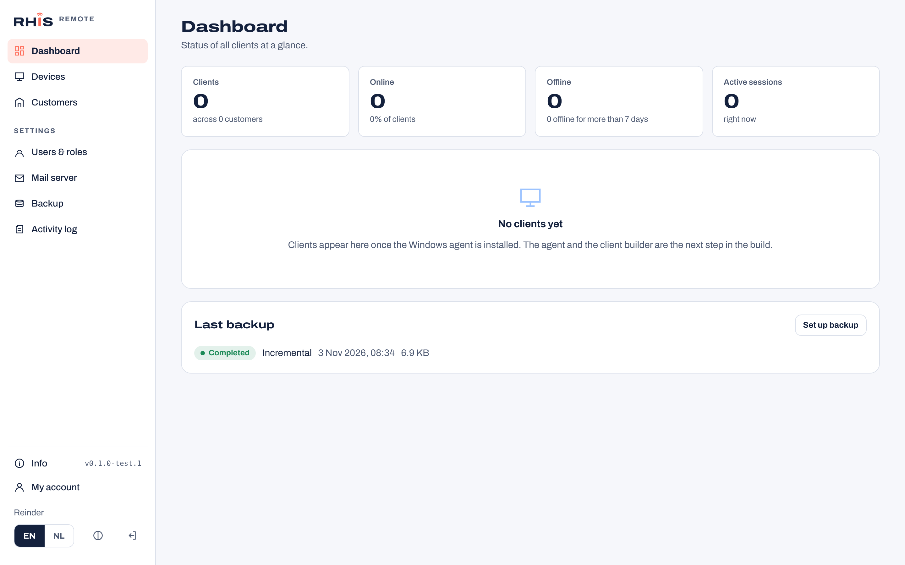
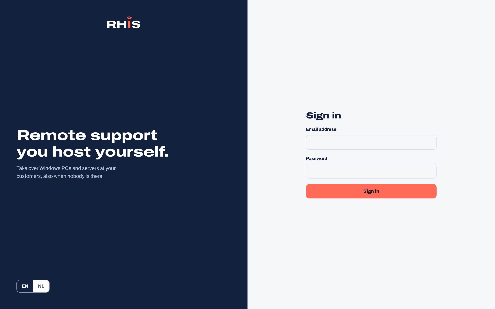
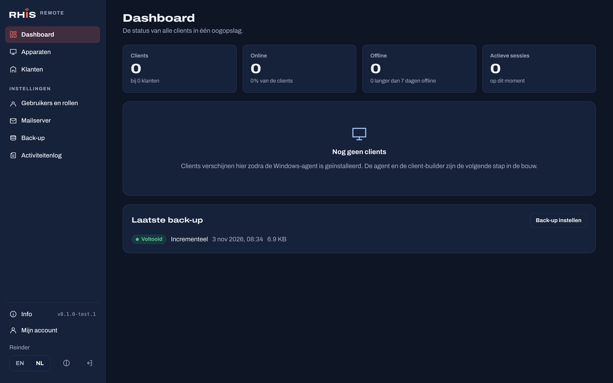
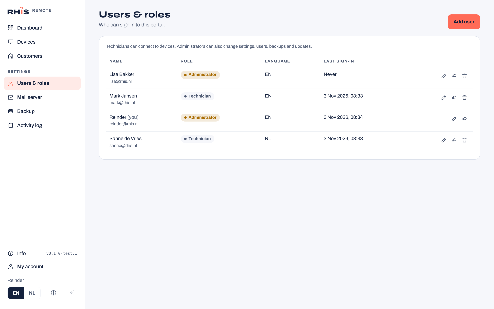
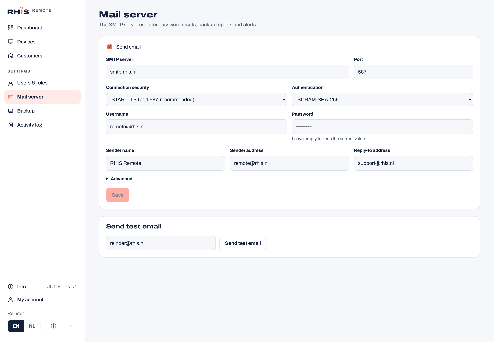
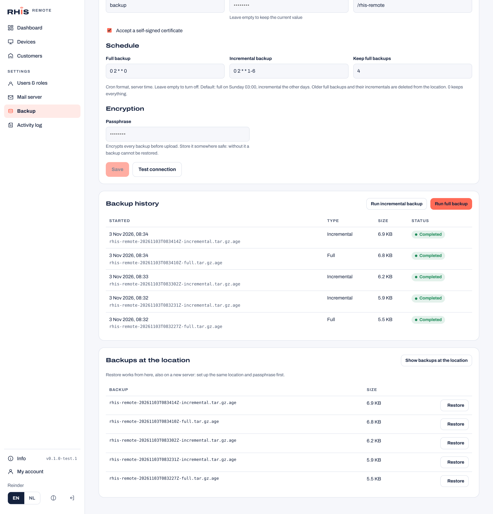
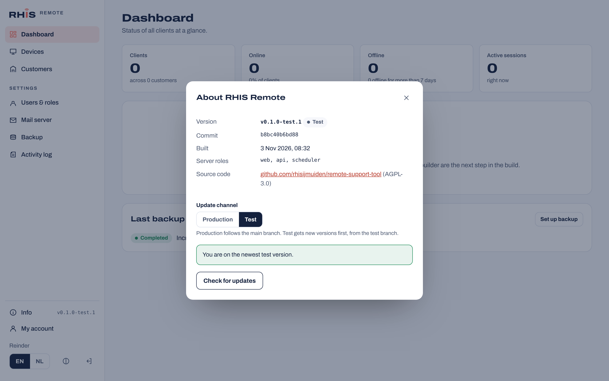
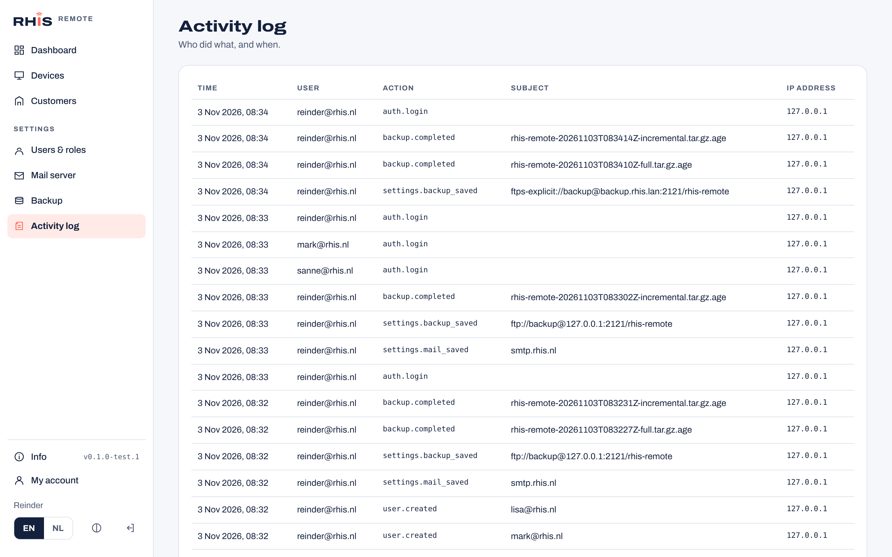

# RHIS Remote

Self-hosted remote support for Windows: remote control with unattended access, a one-off quick support client, and a modular server that runs on a single Debian 13 machine and scales out to multiple servers.

> **Status:** early development. Version 0.1 contains the server foundation and the admin portal. The Windows agent, quick support client and client builder come next, see the [roadmap](ROADMAP.md).



## What is in the server today

- **Admin portal** in the RHIS house style, English by default with a full Dutch translation, light and dark theme, menu on the left.
- **Users and roles:** administrators and technicians, Argon2id password hashing, login rate limiting, activity log.
- **Mail server:** your own SMTP server with STARTTLS or implicit TLS (minimum TLS 1.2 or 1.3), authentication by SCRAM-SHA-256, PLAIN, LOGIN, CRAM-MD5 or XOAUTH2, and a test email from the portal.
- **Backup and restore:** full and incremental backups of the database and data folder to FTP, FTPS (explicit or implicit) or SCP over SSH, on a schedule or by hand, optionally encrypted with [age](https://age-encryption.org). Retention keeps the newest N full backups. Restore works from the remote location, also on a fresh server.
- **Info and updates:** the Info button shows the version and checks GitHub releases. Switch between the production and test channel and install an update from the portal.
- **One binary, several roles:** `roles: ["all"]` on one machine; later roles (gateway, relay) can run on separate servers.

## Screenshots

All screenshots are taken from a real `v0.1.0-test.1` server. The backups shown were made to an FTPS server.

| | |
| --- | --- |
|  **Sign in** |  **Dark theme, Dutch** |
|  **Users and roles** |  **Mail server (SMTP)** |
|  **Backup history and restore** |  **Info, update channel and updates** |
|  **Activity log** | |

## Roadmap

| Phase | Status |
| --- | --- |
| 1. Server foundation | Done (v0.1) |
| 2. Windows agent and connectivity (NAT traversal, WebRTC, relay) | Next |
| 3. Quick support client (no install, session code) | Planned |
| 4. Session audit and recording | Planned |
| 5. Client builder and signed central updates | Planned |
| 6. Multi-server and scale-out | Planned |
| 7. Code signing and open-source release | Planned |

Details per phase are in [ROADMAP.md](ROADMAP.md) and in the [roadmap issues](https://github.com/rhisijmuiden/remote-support-tool/issues?q=label%3Aroadmap).

## Install on Debian 13

```bash
curl -fsSLO https://raw.githubusercontent.com/rhisijmuiden/remote-support-tool/main/deploy/debian/install.sh
sudo bash install.sh --domain remote.example.com   # HTTPS with a Let's Encrypt certificate
# or: sudo bash install.sh                         # https://<server-ip> with an internal certificate
# or: sudo bash install.sh --channel test          # newest test pre-release
```

The installer sets up PostgreSQL, Caddy, a `rhis-remote` system user, `/etc/rhis-remote/config.yaml`, and a hardened systemd service. Open the URL it prints and create the first administrator.

**All traffic is encrypted.** Caddy serves HTTPS on port 443 (HTTP only redirects) and the server itself listens on `127.0.0.1` only. Without `--domain`, Caddy's internal CA issues the certificate; the installer prints the root CA path and SHA-256 fingerprint so you can verify it and trust it on your PCs. The server refuses to start with a plain-HTTP `public_url` or a non-loopback listen address without TLS, unless `allow_insecure_http: true` is set for a lab.

## Branches and releases

| Branch | Channel | Release |
| --- | --- | --- |
| `main` | Production | `vX.Y.Z` from the `VERSION` file |
| `test` | Test | `vX.Y.Z-test.N` pre-release on every push |

Feature work goes into `test` first. The Info screen in the portal switches a server between the two channels.

## Development

Requirements: Go 1.26, Node 22, PostgreSQL 17 (with `pg_dump`/`pg_restore` on the path).

```bash
make web                       # build the portal into the Go binary
make server                    # bin/rhis-remote
RHIS_REMOTE_DATABASE_URL=postgres://localhost/rhis_dev?sslmode=disable \
RHIS_REMOTE_SECRET_KEY=$(./bin/rhis-remote gen-secret) \
RHIS_REMOTE_DATA_DIR=./data ./bin/rhis-remote serve --config config.local.yaml   # http://127.0.0.1:8080
cd web && npm run dev          # portal with hot reload on :5173, API proxied to :8080
RHIS_TEST_DATABASE_URL=postgres://localhost/rhis_test?sslmode=disable make test
```

| Folder | Contents |
| --- | --- |
| `server/` | Go server (`cmd/rhis-remote`, packages in `internal/`) |
| `web/` | React + TypeScript portal (Vite, i18next) |
| `deploy/debian/` | Installer, systemd unit, example config |
| `branding/` | RHIS house style: logos, colors, fonts |
| `docs/screenshots/` | Portal screenshots used in this README |

## Branding

The `branding/` folder holds the RHIS house style used by the portal. Product and company name are set in `config.yaml` under `branding`, so other builds can ship their own name.

## License

Copyright (C) 2026 RHIS.

This project is licensed under the [GNU Affero General Public License v3.0](LICENSE) (AGPL-3.0-only). If you run a modified version as a network service, you must make your source code available to its users. The portal links to this repository from its Info screen.
