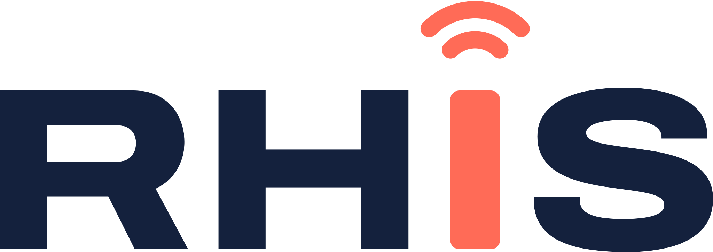

# RHIS huisstijl

Alles van de RHIS-huisstijl op één plek: logo's, kleuren, lettertype, design tokens, het complete logopakket en de beschrijvingen. Gebruik deze repo als bron voor elk nieuw project (website, web-app, CRM, drukwerk, social media).



Het logo is variant **Antenne**: het woordmerk **RHIS** in hoofdletters (Archivo Expanded Extra Bold), waarbij de I een zendmast in koraal is met twee signaalbogen. De volledige regels staan in [huisstijlgids.md](huisstijlgids.md). Een interactieve versie staat in het [design system](https://claude.ai/artifact/JphZ8zRMCYKVhtPw69GkV3).

## Alle huisstijlen

Deze repo is het verzamelpunt voor al mijn huisstijlen. De RHIS-huisstijl staat in de hoofdmap, de huisstijl van elk ander merk of project in een eigen map onder [`projecten/`](projecten). Bij een nieuw project hoef je alleen te zeggen welke huisstijl het krijgt, bijvoorbeeld "bouw dit in de Harder.fm-huisstijl uit `rhis-huisstijl/projecten/harder-fm`".

| Huisstijl | Map | Kort |
| --- | --- | --- |
| RHIS | [`/`](.) (hoofdmap) | Licht, zakelijk: nacht, koraal, Archivo. De standaard voor nieuwe projecten |
| Harder.fm | [`projecten/harder-fm/`](projecten/harder-fm) | Raw hardstyle-radio: zwart, filmkorrel, Anton, signaalrood dat per seizoen en feestdag wisselt |
| Radio Schermer | [`projecten/radioschermer/`](projecten/radioschermer) | Lokale omroep: bijna zwart, signaalrood #EF1428, systeemletter, witte nieuwskaarten |

Elke projectmap heeft dezelfde opbouw: een `README.md` met de gids, `tokens/` (CSS en JSON), `logo/`, `fonts/` en waar nodig `referentie/` en `screenshots/`.

## Wat staat waar

| Map / bestand | Inhoud |
| --- | --- |
| [`huisstijlgids.md`](huisstijlgids.md) | De huisstijlgids: logo-regels, kleuren, typografie, toon en toepassingen |
| [`logo/`](logo) | De bronlogo's: SVG (woordmerk, icoon, antenne, favicon) en PNG in 600, 1200 en 2400 px |
| [`tokens/`](tokens) | Design tokens: `tokens.css` (CSS-variabelen, licht en donker) en `tokens.json` (met uitleg per token) |
| [`fonts/archivo/`](fonts/archivo) | Archivo als variabel webfont (`woff2`) plus `archivo.css`, om zelf te hosten |
| [`logopakket/`](logopakket) | Het complete logopakket: alle formaten, app-iconen, social media, e-mailhandtekening, Microsoft 365 / Entra / Teams en drukwerk (PDF/EPS in CMYK en RGB). Zie [`logopakket/LEESMIJ.md`](logopakket/LEESMIJ.md) en [`overzicht.png`](logopakket/overzicht.png) |
| [`logopakket/_bron/`](logopakket/_bron) | Scripts waarmee het logopakket is gemaakt (Node + Playwright, Python) |
| [`tools/gen-logo.py`](tools/gen-logo.py) | Script dat de logo-SVG's maakt uit het Archivo-lettertype |
| [`web/site.css`](web/site.css) | De stylesheet van rhis.nl, als voorbeeld van de huisstijl op een website |
| [`web/mail-designs/`](web/mail-designs) | De e-mailontwerpen van het CRM (factuur, offerte, herinnering, nieuwsbrief, …) als JSON-ontwerp en kant-en-klare HTML |
| [`projecten/`](projecten) | De huisstijlen van andere merken en projecten, elk in een eigen map |
| [`archief/logo-concepten/`](archief/logo-concepten) | De logoconcepten uit ronde 1 en 2, ter referentie |

De bronbestanden zijn gekopieerd uit de repo `rhis-website` (map `brand/`, `public/fonts`, `public/css`, `resources/mail-designs`, `design/`). Daar staan ze nog steeds, omdat de website ze zelf gebruikt. **Deze repo is de centrale bron**: pas je iets aan de huisstijl aan, doe het hier en kopieer het daarna naar de projecten.

## Kleuren

| Naam | HEX | RGB | CMYK (indicatief) | Gebruik |
| --- | --- | --- | --- | --- |
| Nacht | `#14213D` | 20 33 61 | 95 80 30 45 | Letters, donkere vlakken, footer, primaire knoppen op licht |
| Koraal | `#FF6B57` | 255 107 87 | 0 70 60 0 | De antenne en de belangrijkste call-to-action. Tekst op koraal is altijd nacht |
| Lucht | `#9CC3FF` | 156 195 255 | 40 15 0 0 | Steunkleur op nacht: pills, grafieken, illustraties |
| Wolk | `#F6F7FB` | 246 247 251 | 3 2 0 0 | Lichte achtergrond |

Afgeleide kleuren voor apps (uit `tokens/tokens.css`):

| Token | Licht | Donker |
| --- | --- | --- |
| `surface` | `#F6F7FB` | `#0E1626` |
| `surface-raised` | `#FFFFFF` | `#16213A` |
| `ink` | `#14213D` | `#EEF1F7` |
| `ink-muted` | `#4F5B73` | `#A3AEC4` |
| `line` | `#DCE1EB` | `#26324D` |
| `accent-text` (koraal als tekst) | `#B8392A` | `#FF8A78` |
| `status-online` | `#1C8A57` | `#4ACB8C` |
| `status-warning` | `#A86B00` | `#F2B640` |
| `status-offline` | `#C23434` | `#FF7A7A` |

Puur koraal is als tekstkleur op wit te licht: gebruik daar `accent-text`. Statuskleuren alleen voor status, altijd met tekst of icoon erbij.

## Lettertype: Archivo

Alles in **Archivo** (SIL Open Font License, gratis).

- **Koppen:** de brede variant, `font-stretch: 125%`, gewicht 800 (of 700 voor h2/h3).
- **Lopende tekst:** normale breedte, gewicht 400.
- Maten: display 56/60, h1 40/44, h2 28/34, h3 20/28, body 16/26, small 14/22, label 12/16 (px, grootte/regelhoogte).

Zelf hosten (aanbevolen, geen verzoeken naar Google): kopieer `fonts/archivo/` naar je project en laad `archivo.css`. Of via Google Fonts:

```html
<link href="https://fonts.googleapis.com/css2?family=Archivo:wdth,wght@100..125,400..800&display=swap" rel="stylesheet">
```

## Logo-varianten

| Bestand | Gebruik |
| --- | --- |
| `rhis-logo.svg` | Standaard: nacht + koraal op licht |
| `rhis-logo-wit.svg` | Op nacht of andere donkere achtergronden |
| `rhis-logo-zwart.svg` | Eén kleur zwart: stempels, gravure |
| `rhis-logo-mono-wit.svg` | Eén kleur wit op foto of donker vlak |
| `rhis-icon.svg` | App-icoon, avatar: nacht tegel met koraal antenne |
| `rhis-icon-koraal.svg` | Alternatief icoon voor donkere achtergronden |
| `rhis-antenne.svg` | Alleen de antenne, als beeldelement of laadindicator |
| `favicon.svg` / `favicon.ico` | Browsertabblad |

Regels in het kort: vrije ruimte rondom minimaal de breedte van de H, woordmerk niet kleiner dan 96 px op scherm of 25 mm in druk (daaronder het icoon), de antenne altijd koraal (behalve in de eenkleurige versies), niet vervormen, geen schaduw of verloop, en nooit combineren met het UniFi- of Ubiquiti-logo.

## Gebruiken in een ander project

**Website of web-app (HTML/CSS)**

1. Kopieer `tokens/tokens.css` en `fonts/archivo/` naar je project.
2. Kopieer de bestanden uit `logopakket/02-app-iconen/` naar de webroot en zet de regels uit `html-head.txt` in je `<head>`.
3. Gebruik de variabelen: `background: var(--surface); color: var(--ink);`, knoppen met `var(--accent)` en tekst in `var(--nacht)`, koppen met de klasse `.rhis-display`.
4. Donkere modus werkt vanzelf via `prefers-color-scheme`; forceren kan met `data-theme="light"` of `data-theme="dark"` op `<html>`.

```html
<link rel="stylesheet" href="/fonts/archivo/archivo.css">
<link rel="stylesheet" href="/css/tokens.css">
```

**Laravel + Filament (zoals het RHIS CRM)**

```php
->brandName('RHIS')
->brandLogo(asset('img/rhis-logo.svg'))
->darkModeBrandLogo(asset('img/rhis-logo-wit.svg'))
->brandLogoHeight('1.9rem')
->favicon(asset('img/favicon.svg'))
->font('Archivo', url: asset('fonts/archivo/archivo.css'), provider: LocalFontProvider::class)
->colors([
    'primary' => Color::hex('#FF6B57'),
    'gray' => Color::Slate,
    'info' => Color::hex('#9CC3FF'),
])
->sidebarCollapsibleOnDesktop()
```

Adminmenu's altijd links, logo bovenaan het menu, Info-knop met versie en updates.

**Andere stacks (Tailwind, React, Flutter, …)**

Lees de kleuren, typografie, ruimtes en radius uit `tokens/tokens.json`: elk token heeft een naam, een waarde voor licht en donker en een korte uitleg.

**Als Git-submodule** (houdt projecten automatisch gelijk met deze repo):

```bash
git submodule add https://github.com/rhisijmuiden/rhis-huisstijl.git huisstijl
```

**Drukwerk, Office en social media**

Alles staat klaar in `logopakket/`: PNG's voor Word en PowerPoint, PDF/EPS in CMYK voor de drukker, banners voor LinkedIn, Facebook, X en YouTube, een Outlook-handtekening en de Microsoft 365-huisstijl (Entra-aanmeldscherm, Teams). Uitleg per map in [`logopakket/LEESMIJ.md`](logopakket/LEESMIJ.md).

## Toon

Nederlands, je en jij, zakelijk maar menselijk. Kort en concreet: wat het oplevert, niet hoe het technisch heet. Bijvoorbeeld: "Wifi die gewoon werkt in elke ruimte." Applicaties zijn standaard Engelstalig met een Nederlandse vertaling.

## Opnieuw genereren

- **Logo-SVG's:** `python tools/gen-logo.py <Archivo-ExtraBold-Expanded.ttf> logo/`
- **Logopakket:** `node logopakket/_bron/render.js logo fonts/archivo/archivo-latin.woff2 logopakket`, daarna `python logopakket/_bron/print.py logo logopakket` (drukwerk en favicon.ico) en `node logopakket/_bron/overzicht.js logopakket fonts/archivo/archivo-latin.woff2` (overzichtsblad).
