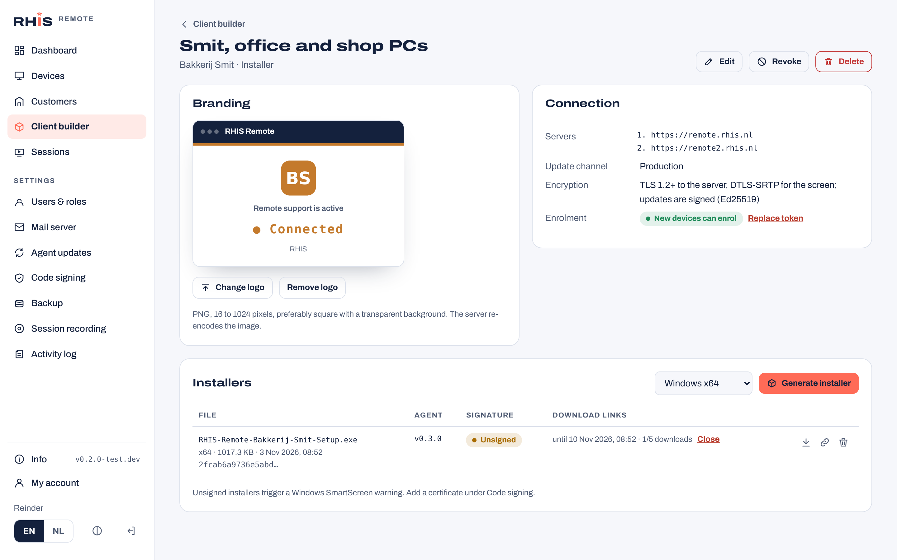

# Client builder and central updates

The server makes branded Windows clients per customer and is the single update source for every agent it has handed out. This page explains how that works and what the agent can rely on.



## In the portal

**Client builder** (all users; changes need an administrator)

1. Add a customer under **Customers**.
2. In **Client builder**, click **New client**: name, customer, type (**Installer** for unattended access or **QuickSupport** without installation), product and company name, accent colour, update channel, and an ordered list of servers. Upload a PNG logo.
3. Click **Generate installer** (x64 or ARM64). The server takes the newest agent of the client's channel, embeds the configuration and signs the file when code signing is set up.
4. Download the installer, or click the link icon to make a **download link** for the customer: valid 1 to 90 days, optionally limited to a number of downloads, closable at any time.

**Revoke** a client to stop its installers from enrolling new devices and close its links; devices that already enrolled keep working. **Replace token** gives the client a new enrolment token, so installers that leaked can no longer add devices.

**Agent updates** (administrators)

- Agent releases are imported from GitHub releases (assets `rhis-agent_windows_<arch>.exe` and `rhis-quick_windows_<arch>.exe`, checked against `checksums.txt` or `<asset>.sha256`) every hour, or with **Check GitHub**. An administrator can also upload an executable.
- **Update policy**: turn automatic updates on or off, follow the newest release or pin a version per channel (pinning an older version rolls devices back), and set a **staged rollout** percentage. Every device gets a fixed bucket per version, so raising the percentage only adds devices.
- **Customer exceptions**: no updates for one customer, or hold that customer at a version.
- The page shows which versions are in use and what agents reported while updating.

**Code signing** (administrators): see [below](#code-signing).

## Security

- **Every server address must be `https://`.** The builder refuses anything else, so a client can only talk to the server over TLS. Screen and input go over WebRTC (DTLS-SRTP) or the relay inside the same TLS WebSocket (see the agent protocol, `docs/agent-protocol.md`, which comes with the Windows agent).
- **Signed updates.** On first start the server creates an Ed25519 key pair. The private key is stored in the database, encrypted with `secret_key`, so every server of a cluster and a restored backup use the same key. The public key is embedded in every client. An agent installs an update only when the manifest verifies against one of its embedded keys, has not expired, and the downloaded file matches the size and SHA-256 in the manifest. A manifest is valid for 24 hours and names the device it was issued to.
- **No downgrades by accident.** "Newest release" never moves a device back; only a pinned version (global or per customer) can, and the manifest then says `allow_downgrade: true`.
- **Enrolment tokens** are 32 random bytes; the database keeps a SHA-256 hash for lookups and an encrypted copy so a rebuilt installer keeps the same token. **Download links** store only a hash; the link itself is shown once.
- **Logos** are decoded and encoded again by the server before they are embedded, which drops metadata and anything that is not a plain image.
- **The signing command** can only be set in `config.yaml`, never from the portal, so a portal account can not make the server run programs.

## Code signing

Without a signature, Windows SmartScreen warns customers before they can run an installer. Two methods are supported:

| Method | When | How |
| --- | --- | --- |
| Certificate file (PFX) | An internal certificate, or an older public certificate with an exportable key | Upload the `.pfx` and password in the portal. The server checks the password, the code signing usage and the expiry date, stores it encrypted and signs with [osslsigncode](https://github.com/mtrojnar/osslsigncode). |
| Signing command | Public certificates issued since June 2023, whose key lives on a hardware token, an HSM or a cloud service | Set `code_signing.command` in `config.yaml`, for example with [jsign](https://ebourg.github.io/jsign/): `jsign --storetype YUBIKEY --storepass "PIN" --tsaurl {timestamp} --name {name} {in}`. `{in}`, `{out}`, `{name}`, `{url}` and `{timestamp}` are replaced. Without `{out}` the tool must sign `{in}` in place. |

Signatures get an RFC 3161 timestamp (default `http://timestamp.digicert.com`), so they stay valid after the certificate expires. Generated installers are signed, and so are uploaded or imported agent releases that are not signed yet. Agent releases that CI already signed are served as they are.

## For the agent: the embedded configuration

The server appends the configuration to the agent executable as a trailer. When the file is then Authenticode-signed, the certificate table follows the trailer.

```
[agent .exe][zero padding][UTF-8 JSON][uint32 little-endian JSON length]["RHISCFG1"][certificate table, if signed]
```

The padding makes the trailer end on an 8-byte boundary. To read it: take the PE security data directory (index 4). If it is set, `end` is its file offset, otherwise the file size. The last 8 bytes before `end` are `RHISCFG1`, the 4 bytes before that the JSON length. `server/internal/builder/config.go` (`Extract`) is the reference reader.

```json
{
  "v": 1,
  "build_id": 12,
  "product_name": "RHIS Remote",
  "company_name": "RHIS",
  "logo_png": "<base64 PNG, max 256 KB>",
  "accent_color": "#FF6B57",
  "servers": ["https://remote.rhis.nl", "https://remote2.rhis.nl"],
  "enroll_token": "rbe_…",
  "mode": "install",
  "channel": "production",
  "update_keys": ["<base64 Ed25519 public key>"]
}
```

`servers` is a failover list in order. The agent passes `enroll_token` to `POST /api/agent/v1/enroll`, which resolves it to the build's customer. At install time the agent copies the whole configuration into `agent.json`, because update files come without a trailer.

## For the agent: updates

All requests use the device token (`Authorization: Bearer …`).

```http
GET /api/agent/v1/update?product=agent&os=windows&arch=amd64&version=v0.2.0&channel=production
→ 204 No Content                       (nothing to do)
→ 200 {"manifest": "<base64 JSON>", "signature": "<base64 Ed25519>"}
```

The signature covers `"rhis-agent-update-v1\0"` followed by the exact manifest bytes. The manifest:

```json
{
  "product": "rhis-agent", "version": "v0.3.0", "os": "windows", "arch": "amd64",
  "size": 4815162, "sha256": "…", "url": "https://remote.rhis.nl/api/agent/v1/files/<sha256>",
  "released_at": "…", "issued_at": "…", "expires_at": "…", "device_id": 12, "allow_downgrade": false
}
```

The agent checks the signature against `update_keys`, `expires_at`, `device_id`, and `allow_downgrade` when the version is older; downloads `url` (same bearer token, supports `Range`); checks size and SHA-256; then swaps itself. It reports progress:

```http
POST /api/agent/v1/update/report
{"from_version": "v0.2.0", "to_version": "v0.3.0", "status": "downloaded" | "installed" | "failed", "error": "…"}
```

`server/internal/agentupdate/signing.go` (`Verify`) is the reference verifier.

## Configuration

```yaml
agents:
  repo: ""              # GitHub repository with agent releases (default: update.repo)
  sync_interval: "1h"   # "0" imports only when you click Check GitHub
  keep: 5               # releases kept per product, architecture and channel (pinned versions always stay)
code_signing:
  command: ""           # see Code signing
roles: ["all"]          # the "update" role serves /api/agent/v1/update, /files and the /d/ download links
```
