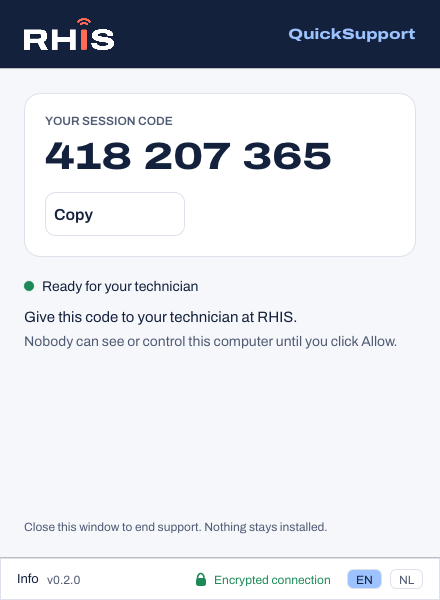
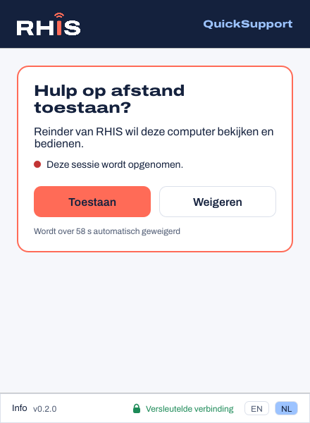
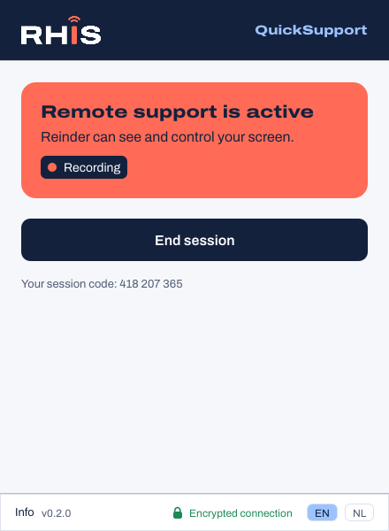
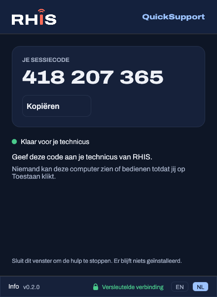
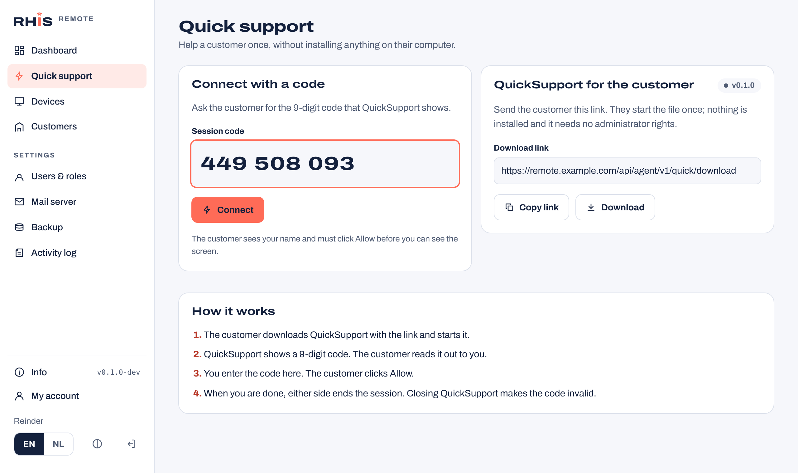

# QuickSupport

QuickSupport is a single portable `.exe` for one-off support. The customer downloads it from your server, starts it, and reads out a 9-digit code. Nothing is installed, no administrator rights are needed, and the code stops working as soon as the window closes.

| Customer: code | Customer: allow the request | Customer: session active | Dark theme, Dutch |
| --- | --- | --- | --- |
|  |  |  |  |

The technician enters the code in the portal under **Quick support**, where the download link for customers is too:



## How a session goes

1. The customer opens the download link (`https://<server>/api/agent/v1/quick/download`). The server appends its own address to the exe, so the customer only has to start it.
2. QuickSupport registers with the server over HTTPS and gets a device code and a device token. It shows the code.
3. QuickSupport opens the same control channel (WSS) as the Windows agent, see [agent-protocol.md](agent-protocol.md).
4. The technician enters the code in the portal. The server sends a `session_request` with kind `quick` and the technician's name.
5. QuickSupport brings its window to the front and asks the customer to **Allow** or **Decline**. Without an answer it declines after 60 seconds.
6. After Allow, the screen is shared over WebRTC (or the WSS relay). The customer sees who is connected, whether the session is recorded, and an **End session** button.
7. Closing the window tells the server to retire the device: its token is removed and the code is freed. If the client disappears without saying so, the server retires it after 3 minutes offline.

## Security

- **Everything is encrypted.** QuickSupport only accepts `https://` server addresses. The control and session sockets are WSS, and the screen stream is WebRTC with DTLS-SRTP. Certificates are checked against the Windows certificate store. The `--insecure-dev` flag allows `http://` to a loopback address only, for development; the window then shows "Not encrypted (development)" in red.
- **Consent first.** A code alone never gives access: the customer must click Allow for every session.
- **Guessing codes does not work.** Codes have 9 digits (900 million options) and only exist while a QuickSupport window is open. A technician gets 20 wrong codes per 15 minutes; unknown and offline codes give the same answer. Registrations are limited to 30 per IP address per 15 minutes.
- **Separate from managed devices.** Quick devices have kind `quick`: they are not listed under Devices, not counted on the dashboard, and an agent's code cannot be used on the Quick support page.
- **No secrets in the download.** The appended block holds only the server addresses, branding and public update keys.
- Every step is in the activity log: `quick.registered`, `session.started`, `quick.code_not_found`, `quick.closed`.

## Configuration

QuickSupport looks for its server in this order:

1. `--server https://remote.example.com` on the command line
2. The configuration the server or the client builder appends to the exe, in the client builder layout (`[padding][JSON][u32 length]RHISCFG1`, see client-builder.md); `servers` is a failover list
3. `rhis-quicksupport.json` next to the exe: `{"servers": ["https://remote.example.com"], "company_name": "RHIS"}`
4. `RHIS_SERVER_URL` at build time

The server serves the exe from `gateway.agent_dir` (default `/opt/rhis-remote/agent`): `rhis-quick_windows_amd64.exe` plus `client.version` (the version of the Windows client workspace). Releases include both and the installer puts them there.

**Code signing:** the trailer sits before the Authenticode certificate table, so the client builder can sign a build after adding it. The plain download link appends it to the released exe as is.

## Info and updates

The **Info** button shows the version, the server and the license, and checks `GET /api/agent/v1/quick/latest`. When the server has a newer QuickSupport, **Download and restart** downloads it, checks its SHA-256, starts the new copy and closes the old one (which gets a new code). The release channel follows the server.

## Development

```bash
cd client
cargo test
cargo run -p rhis-quicksupport -- --demo                 # whole flow without a server
cargo run -p rhis-quicksupport -- --demo --lang nl
cargo run -p rhis-quicksupport -- --server http://127.0.0.1:8080 --insecure-dev
```

`--demo` plays the flow with a fake technician. `RHIS_QS_DEMO_STEP=ready|request|active|offline|connecting` holds one screen and `RHIS_QS_THEME=light|dark` forces a theme; both are used for the screenshots. Windows builds come from CI; a Linux build is only for development (it shares a generated test screen instead of the real one).
